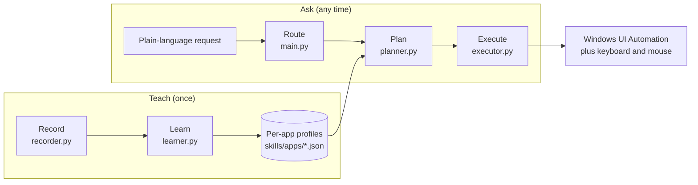

# OttR: A computer use AI 

**Teach your Windows PC a task once. Ask for it in plain English. It does the work locally.**

OttR is a local, open-source desktop assistant for Windows that automates repetitive tasks by interacting directly with the native Windows UI, rather than guessing based on screen pixels or sending your data to the cloud.

| | |
|---|---|
| **Status** | Early alpha. The core flow has run on the author's Windows machine for simple tasks. The latest refactor has so far been tested only against simulated Windows APIs, so verifying it on real Windows is our first milestone ([section 3](#3-first-milestone-one-flow-ten-clean-runs)). |
| **Target Platform** | Windows 11  |
| **Language** | Python, about 3,500 lines, no framework |
| **AI** | A small local model through [Ollama](https://ollama.com) (default `llama3.2:1b`). |
| **We are looking for** | Contributors with Windows UI Automation, Python testing / CI, local-LLM, or documentation experience |
| **Start here** | [First milestone](#3-first-milestone-one-flow-ten-clean-runs) and [Why join](#4-why-join) |

---

## Contents

1. [The problem](#1-the-problem)
   - [1.1 What hurts](#11-what-hurts)
   - [1.2 Who feels it](#12-who-feels-it)
   - [1.3 Why existing tools fall short](#13-why-existing-tools-fall-short)
   - [1.4 Our bet](#14-our-bet)
   - [1.5 What this project is not](#15-what-this-project-is-not)
2. [Technical plan](#2-technical-plan)
   - [2.1 How it works](#21-how-it-works)
   - [2.2 The pipeline, step by step](#22-the-pipeline-step-by-step)
   - [2.3 Data model](#23-data-model)
   - [2.4 What we tried, what worked, what failed](#24-what-we-tried-what-worked-what-failed)
   - [2.5 What needs to be built next](#25-what-needs-to-be-built-next)
   - [2.6 Known limitations](#26-known-limitations)
   - [2.7 Open design questions](#27-open-design-questions)
3. [First milestone: one flow, ten clean runs](#3-first-milestone-one-flow-ten-clean-runs)
   - [3.1 Goal](#31-goal)
   - [3.2 Work packages](#32-work-packages)
   - [3.3 Definition of done](#33-definition-of-done)
   - [3.4 Out of scope](#34-out-of-scope)
   - [3.5 How to claim a task](#35-how-to-claim-a-task)
4. [Why join](#4-why-join)
5. [Getting started](#5-getting-started)
6. [How to contribute](#6-how-to-contribute)
7. [Safety and privacy](#7-safety-and-privacy)
8. [FAQ](#8-faq)
9. [Glossary](#9-glossary)
10. [License and contact](#10-license-and-contact)

---

## 1. The problem

### 1.1 What hurts

Much of everyday Windows work is clicking through the same screens again and again: switching a setting that is five menus deep, configuring an app the same way on every machine, running the same routine every morning. Most of these apps have no API and no command line. The only interface is the graphical one, so the only way to automate them is to drive the GUI.

Today that leaves two bad options:

- **Do it by hand**, every time.
- **Automate it**, which means learning a scripting tool, writing code that is tied to screen coordinates or window layouts, and fixing it when an update moves a button.

### 1.2 Who feels it

- **Non-programmers with repetitive desktop routines.** Office workers, students, and small-business owners who know exactly what they want done but cannot script it.
- **IT and help-desk staff** who apply the same configuration across many machines and users.
- **People who would benefit from hands-free or voice-driven control of the PC,** for example because of motor or accessibility needs. This is a direction the design allows for, not something the project has tested with users yet.
- **Testers and developers** who want quick UI automation without building a framework.
- **Privacy-conscious people and organizations** who cannot send screenshots of their desktop to a cloud service.

### 1.3 Why existing tools fall short

This is a general comparison of the kinds of tools that exist, not a review of specific products. Capabilities vary, so please open an issue if you think a row is unfair.

| Kind of tool | What it does well | Where it falls short for this problem |
|---|---|---|
| **Script tools** (AutoHotkey, PyAutoGUI, shell scripts) | Powerful and free | You must write and maintain code. Coordinate-based scripts break when a window moves. There is no natural-language interface. |
| **Visual RPA suites** (flow builders) | Robust and enterprise-ready | You still design every flow by hand. They tend to be heavy, account- or license-bound, and built for organizations rather than individuals. |
| **Cloud "computer use" agents** | Flexible: they can attempt tasks they have never seen | Each action involves sending screenshots to a cloud model, so it is slower, costs money per run, and raises privacy concerns. Behavior is not repeatable, which is a poor fit for routines that must work the same way every time. |
| **Built-in OS voice and assistant features** | Zero setup | They cover a fixed list of supported actions. They cannot learn *your* tasks in *your* apps. |

### 1.4 Our bet

1. **Learn by demonstration.** You do the task once. The system records what you did and turns it into a reusable, human-readable skill.
2. **Deterministic replay.** Skills are replayed through the Windows accessibility tree (UI Automation). Elements are found by name, type and ID rather than by pixel position. Replaying costs no model calls.
3. **The model is used only for language.** A small local model picks which skill a request means and pulls out parameters such as "search for *flutter*". It never decides which pixel to click.
4. **Local and inspectable.** Everything runs on your machine. Skills are plain JSON files you can read, edit, and share. Nothing is a black box.

The trade-off is honest: this works best in apps with decent accessibility information. For apps without it (games, some Java and custom-drawn UIs) we fall back to relative positions inside the window, which is less reliable, and image matching is not built yet (see [2.5](#25-what-needs-to-be-built-next)).

### 1.5 What this project is not

- Not a general autonomous agent that figures out unseen tasks on its own (a possible later layer, see the roadmap).
- Not cross-platform. It is built on Windows UI Automation.
- Not a tool for bypassing logins, CAPTCHAs, or access controls.

---

## 2. Technical plan

### 2.1 How it works



The system has two phases. In **Teach**, you use your computer normally while the recorder watches. The learner splits the recording by application and into small independent actions, then saves them. In **Ask**, you type a request. The router decides whether it matches a saved skill, a learned app, or a built-in tool. The planner turns it into an ordered list of steps and shows it to you. After you confirm, the executor performs it.

### 2.2 The pipeline, step by step

1. **Record** (`recorder.py`). Listens for clicks, typed text and key presses, and tracks window open / close / minimize events. For each click it asks UI Automation what element was under the cursor and saves its name, control type, AutomationId, parent, and resulting state (selected, toggled). Password fields are detected and never stored. F7 pauses, F8 stops.
2. **Learn** (`learner.py`). Ignores the host terminal and the Windows shell, works out how each app was launched, cuts the activity into small actions (a state-changing click is its own action), and merges the result into `skills/apps/<app>.json`. The raw recording is then deleted.
3. **Route** (`main.py`). Tries, in order: a saved task skill, the learned-app planner, then a small local model constrained to a JSON schema that chooses one of a fixed set of tools. Destructive tools ask for confirmation.
4. **Plan** (`planner.py`). Splits the request into clauses, finds the app and the matching learned actions, orders them as asked, and shows you the plan, including which steps would be skipped if the state already holds. It also writes a flowchart HTML page of the plan.
5. **Execute** (`executor.py`). Finds each element (trying several search strategies, in order of specificity), clicks or types, and stops at the first failure. F9 aborts at any time.

### 2.3 Data model

A learned app profile (shortened):

```json
{
  "app": "SystemSettings.exe",
  "aliases": ["settings"],
  "search_name": "settings",
  "direct_launch": false,
  "launch_steps": [
    { "action": "click_element",
      "target": { "name": "Settings", "control_type": "ButtonControl", "automation_id": "Settings" },
      "app": "explorer.exe" }
  ],
  "actions": [
    {
      "name": "Select Colors",
      "signature": "3f2a9c1d7b04",
      "after": ["a81b0c55e2d9"],
      "postcondition": {
        "target": { "name": "Colors", "control_type": "ListItemControl", "automation_id": "" },
        "state": { "selected": true }
      },
      "steps": [
        { "action": "click_element",
          "target": { "name": "Colors", "control_type": "ListItemControl",
                      "automation_id": "", "parent_name": "" },
          "app": "SystemSettings.exe",
          "state_after": { "selected": true } }
      ]
    }
  ],
  "sessions": 2
}
```

Step types the executor understands:

| `action` | Meaning |
|---|---|
| `click_element`, `double_click_element`, `right_click_element`, `middle_click_element` | Find a UI element and click it. If it has no visible area, activate it through Invoke / Select / Toggle / Expand instead. |
| `click_position` (and double / right / middle) | Click at a recorded relative position inside the app window (for apps with no accessibility info). |
| `type_text` | Type text. Supports `{parameter}` placeholders. |
| `press_key` | Press a key or combination such as `enter` or `ctrl+shift+s`, with an optional `repeat`. |
| `enter_password` | Ask for the password in the terminal at run time. It is never stored. |

Two fields drive the "smart" behavior:

- **`postcondition`.** The state an action leaves behind. If it already holds (for example the option is already selected), the action is skipped.
- **`after`.** The actions you had done earlier in that app. At run time they are used only if the target is not currently on screen, so the replay can navigate back to it.

### 2.4 What we tried, what worked, what failed

| Approach | Result | What we learned |
|---|---|---|
| Let the small LLM write the skill steps | Failed. Outputs were unreliable and tended to copy the template. | Steps are now built by plain code. The model only suggests a name and description, with its output forced into a JSON schema. |
| Let the 1B model choose tools from free text | Unreliable. Wrong tools, invalid JSON. | Added keyword checks, a skill shortlist, schema-constrained output, and confirmation for risky tools. A larger model is probably worth testing. |
| Teach one named task at a time (`/teach`) | Works, but you must demonstrate each task separately. | `/learn` records a free-form session and splits it into per-app knowledge automatically. Both flows exist. |
| Click by AutomationId first | Failed for WinUI apps. Many elements share generic IDs like `ContentPresenter`. | Names and control types are tried first, and generic IDs are used only as a last resort. |
| Call `Click()` and trust it | Failed silently. Elements with a zero-size rectangle log an error and return without raising, so the step looked successful. | Check the rectangle first. Use pattern-based activation if it is empty, and fail loudly if nothing works. |
| Use UI Automation from the input-listener threads | Failed with `CoInitialize has not been called`. | All UI Automation work now happens in one worker thread with its own initializer. |
| Open the Start menu and type the app name quickly | Windows Search dropped characters. | Type character by character with delays. Prefer launching the executable directly when possible. |
| Treat Store / UWP apps like normal apps | Their windows belong to `ApplicationFrameHost.exe`. | The real app is resolved from child windows and window titles. |
| Dropdown and list items | They exist in the UI tree only while the dropdown is open. | The executor opens candidate dropdowns while searching and closes them again if the target was not inside. |
| No automated tests | A refactor lost the typing and key-press handlers and nothing noticed. | Tests are the first thing we need ([milestone 1](#3-first-milestone-one-flow-ten-clean-runs)). |

### 2.5 What needs to be built next

| Priority | Item | Why |
|---|---|---|
| **P0** | Automated tests and CI | The codebase has none. Regressions go unnoticed. |
| **P0** | Verify each step actually worked | A step is currently "successful" if the click was sent. We never check the effect. |
| **P0** | Reliability measurement on real Windows | We have no success-rate number for any flow. |
| **P1** | Dry-run mode (resolve every element without clicking) | Tells you whether a saved skill still matches today's UI. |
| **P1** | Logging and a per-run report | Makes failures debuggable. Replaces `print`. |
| **P1** | Packaging (`requirements.txt`, `pyproject.toml`, a console command) | Right now it is a folder of scripts. |
| **P2** | Image-based matching for unlabeled elements | Crops are recorded but never used. |
| **P2** | Self-healing locators (fall back to similar names or positions and report the change) | UI updates break exact-name matches. |
| **P2** | Skill export / import format with versioning | Share skills between machines and people. |
| **P3** | Optional vision-model fallback for unseen tasks | A possible later layer. Replay stays the default. |
| **P3** | System tray or small GUI | Replace the terminal. |
| **P3** | Localization (non-English Windows UI names) | Names are matched as text, so other languages need care. |

### 2.6 Known limitations

- Windows only, and it needs a visible, unlocked desktop. The mouse is physically moved, so you cannot use the computer during a run.
- Quality depends on how well an app exposes accessibility information.
- Skills match by name, so a different Windows language or a renamed option can break them.
- Image matching and result verification are not implemented yet.
- Request parsing is keyword-based. Complex or ambiguous requests may be misunderstood. That is why a confirmation step always shows the plan first.
- Test coverage is currently zero in the repository.

### 2.7 Open design questions

These are good first discussions, and your opinion counts here.

1. What is the best way to **verify** that a click did what it should (state read-back, window or title change, appearance of an expected element)?
2. Should skills be **named, versioned, shareable files** in a registry, or stay local?
3. How should we **test UI automation** in CI? GitHub's Windows runners have a desktop session, but UI Automation behavior there needs investigation.
4. What is the right **fallback ladder** when an element cannot be found (similar name, relative position, image match, ask the user)?
5. Is a **larger local model** worth the cost for routing, or should routing become a classifier over saved skills?

---

## 3. First milestone: one flow, ten clean runs

### 3.1 Goal

> Record the flow **Settings → Personalization → Colors → choose a color mode** once, then replay it **10 times in a row on a clean Windows 11 machine or VM**, with each run **checked by code** rather than by eye. A new contributor can set the project up from the README in under 30 minutes.

This is small on purpose. It needs no new features, only the foundations that make every later feature safe to build: tests, verification, measurement and a clean setup. Estimated effort: **1 to 2 weeks for 2 to 4 contributors** working in parallel.

### 3.2 Work packages

Each package is meant to become one GitHub issue. Sizes: **S** is about a day, **M** is about 2 to 4 days.

| # | Task | Size | Needs Windows? | What to deliver |
|---|---|---|---|---|
| **A** | **Test foundation and CI** | M | No (logic) / yes (smoke) | A `tests/` folder with pytest. Fake UI Automation and keyboard fixtures. Tests for `common`, `learner`, `planner` and `executor`'s key and text handling. A GitHub Actions workflow: logic tests on Linux, import smoke test on `windows-latest`. |
| **B** | **Packaging and quick start** | S | Yes | `requirements.txt` (and optionally `pyproject.toml`), tested on a fresh machine. README setup instructions corrected based on what actually happens. |
| **C** | **Step verification** | M | Yes | After each click, check the effect (for example the element's selected / toggle state, or an expected element appearing) and report each step as `verified`, `unverified` or `failed`. Include a short design note. |
| **D** | **Dry-run mode** | S–M | Yes | `--dry-run` for a skill or plan: find every target element, print what was found and how, click nothing. |
| **E** | **Logging and run report** | S | No | Replace `print` with `logging`. Write a JSON report per run: steps, durations, which search strategy matched, errors. |
| **F** | **Reliability benchmark** | M | Yes | A script that replays the reference flow N times and reports the success rate and failure reasons. This produces the "10 out of 10" number. |

**Suggested order:** A and B in parallel first. Then C, D and E. F last, since it uses everything else.

**Good first issues** (each under a day, no deep context needed): fix typos and unclear messages, add a `.gitignore` (see [section 7](#7-safety-and-privacy)), bundle Mermaid locally so the flowchart pages work offline, add `--help` text, add type hints to `common.py`, write a short "how to record a good demo" guide.

### 3.3 Definition of done

- [ ] `pytest` passes locally and in CI on every pull request.
- [ ] A fresh clone can be installed and run by following the README alone.
- [ ] The reference flow has been recorded and saved in the repository (without personal data).
- [ ] Replaying the reference flow 10 times in a row succeeds 10 out of 10, as reported by the benchmark script, on a clean Windows 11 machine or VM. If it does not, the failures are documented as issues with their causes.
- [ ] Every step in a run is reported as verified, unverified or failed, and the run report is saved.
- [ ] `--dry-run` works for the reference flow.

### 3.4 Out of scope

New apps, image matching, a GUI, a larger model, cross-platform support, and skill sharing. They are all valuable, and all of them need this foundation first.

### 3.5 How to claim a task

1. Open the issue labeled `milestone-1` for the task you want, or open one using the table above.
2. Comment "I'll take this" with a one-line plan. We will assign it to you.
3. Open a draft pull request early. Small, frequent pull requests are easier to review than one big one.
4. Not sure which task fits your skills or your free time? Ask in Discussions.

---

## 4. Why join

### A real technical challenge

- **Windows UI Automation and COM.** Threading rules, patterns, WinUI quirks, store apps hiding behind frame hosts. There is very little polished open-source work here.
- **Making flaky things reliable.** Element search strategies, timing, recovery, and verifying that an action really happened.
- **Testing code that controls a desktop.** Faking the OS well enough to test logic, then proving it on real machines.
- **Small local models used sensibly.** Constraining outputs, deciding what the model should and should not do, and measuring it.

### Real influence, early

The whole codebase is about 3,500 lines. A single pull request can change the architecture. The design questions in [2.7](#27-open-design-questions) are open, and contributors decide them with the maintainers.

### A portfolio piece with substance

You will leave with public, reviewable work on a hard problem: tests, CI, a verification system, a benchmark. You will have credit in the history, the contributors list and release notes, and a project you can explain in an interview.

### Startup and founding-team experience

If this grows into a product or company, we want the people who built it to be part of it. To be clear and fair: **there is no equity or paid role on offer today, and we will not imply there is.** Anything of that kind would be discussed with each person individually and agreed in writing, well before it matters. What we can promise now is early ownership of real decisions, visible credit, and a path to becoming a maintainer.

### Who we are looking for

| Role | What you would do |
|---|---|
| **Windows / UI Automation developer** | Make element finding, clicking and verification solid. |
| **Python tester / CI engineer** | Build the test foundation and the pipeline. |
| **Local-LLM practitioner** | Improve routing and parameter extraction. Evaluate models. |
| **Technical writer / designer** | Docs, tutorials, demo recordings, and the future GUI. |
| **Security-minded reviewer** | Review the recording, privacy and safety design. |
| **Tester with a Windows machine** | Run the benchmark on different setups and report what breaks. |

You do not need to be an expert in all of this. Ask questions and we will point you at the right place.

---

## 5. Getting started

### Requirements

- Windows 10 or 11, with a visible, unlocked desktop
- Python 3.10 or newer
- [Ollama](https://ollama.com) running locally, with the default model pulled:

```bash
ollama pull llama3.2:1b
```

### Install

```bash
git clone https://github.com/<owner>/<repo>.git
cd <repo>
python -m venv .venv
.venv\Scripts\activate
pip install psutil uiautomation pynput pillow ollama pycaw comtypes
```

(`pillow` is optional and only used for recording small image crops. A proper `requirements.txt` is part of [milestone 1](#32-work-packages).)

### Run

```bash
python main.py
```

Optional: use a different model with `set ASSISTANT_MODEL=llama3.2:3b` before starting.

| Command | What it does |
|---|---|
| `/learn` | Record a free-form session (F7 pause, F8 stop). The assistant works out apps and actions by itself. |
| `/teach <task>` | Record one named task and save it as a skill. |
| `/skills` | List what has been learned. |
| anything else | Treated as a request. |

An illustrative session (output abbreviated):

```text
You> open settings, then dark and colors

Here is what I understood:
  1. Open Settings (bring it to the front if it is already open)
  2. In Settings: Select Dark  [skipped if already selected/on]  [if its target is not on screen, first: Select Personalization; Select Colors]
  3. In Settings: Select Colors
Run this? [y/N]: y
Starting in 3 seconds. Do not touch the mouse. Press F9 to abort.
```

You can also run a saved task directly: `python executor.py --list`, then `python executor.py <skill> --yes`.

### Repository map

| File | Role |
|---|---|
| `main.py` | Interactive loop and request router. Built-in tools (volume, battery, processes, open app, rename file). |
| `recorder.py` | Records clicks, typing, keys and window events. Worker thread for UI Automation. |
| `learner.py` | Turns a recording into per-app profiles. Also generates a flowchart of what was learned. |
| `planner.py` | Request → ordered plan. Launching, closing and restoring apps. Runs the plan. |
| `executor.py` | Finds elements and performs steps (clicks, typing, keys, passwords). |
| `skill_builder.py` | The `/teach` flow: recording → one named skill. |
| `edit_skill.py` | Command-line tool to trim and rename a saved skill. |
| `common.py` | Shared helpers (text, steps, JSON, flowchart pages). Pure Python. |
| `winapi.py` | Shared Win32 helpers (windows, processes, focus). Windows only. |

The pure-logic modules (`common`, `learner`, `planner`, `edit_skill`) import on any operating system, so most of the logic can be developed and tested without Windows. Everything that touches the real desktop needs Windows.

---

## 6. How to contribute

1. **Pick or propose a task.** See [3.2](#32-work-packages), the `good first issue` label, or open an issue to discuss an idea first.
2. **Fork, branch, build.** Use a descriptive branch name such as `feature/dry-run`.
3. **Keep it small and tested.** Add tests for new logic. Say in the pull request what you ran on real Windows and what you only tested with fakes.
4. **Open a pull request** and link the issue. Draft pull requests are welcome.
5. **Review.** Maintainers will respond with questions and suggestions. We aim for friendly, specific feedback.

**Pull request checklist**

- [ ] The change does one thing and the description says why.
- [ ] Tests added or updated.
- [ ] No personal data in the diff (recordings, profiles, screenshots, crops).
- [ ] No new dependency without discussing it first.
- [ ] Clear error messages: a failed step should say what was missing and where.

**Code style.** Plain, readable Python. Small functions. Comments that explain *why*. Windows-specific code stays in `winapi.py`, `executor.py`, `recorder.py` and the run functions of `planner.py`, so the rest stays testable anywhere.

**Communication.** GitHub Issues for bugs and tasks, GitHub Discussions for ideas and questions.

Have questions, ideas, or suggestions? Join the conversation on
[GitHub Discussions](https://github.com/VineetHegde/OttR/discussions).

New to the community? Start with our
[welcome discussion](https://github.com/VineetHegde/OttR/discussions/1).

**Conduct.** Be kind, assume good intent, and critique code, not people. A full `CODE_OF_CONDUCT.md` will be added.

---

## 7. Safety and privacy

This project records what you type and click, so it takes that seriously.

- **Local only.** The assistant talks only to your local Ollama server. There is no telemetry. (The generated flowchart pages load the Mermaid script from a CDN when you open them in a browser.)
- **Passwords are never stored.** Password fields are detected and recorded only as "ask at run time". F7 pauses recording for anything else private.
- **Raw recordings are temporary.** `raw_recording.json` can contain text you typed. It is deleted after learning succeeds, and kept if learning fails so the demonstration is not lost. Delete it yourself once you are done.
- **You confirm before anything runs.** The plan is shown first, and destructive tools (such as renaming a file) ask again. F9 aborts at any time.
- **Fixed app launcher.** The built-in "open app" tool only starts programs from a short allowlist.
- **Do not commit your data.** Recordings, learned profiles and image crops can contain personal information. Add this to your `.gitignore` (the repository should ship with it):

```gitignore
raw_recording.json
skills/
execute_Output/
learn_Output/
.venv/
__pycache__/
```

If you find a security or privacy problem, please report it privately to the maintainers rather than in a public issue. [Add contact.]

---

## 8. FAQ

**Why not just use a cloud computer-use agent?**
They are impressive for tasks they have never seen. For a routine you repeat, they are slower, cost per run, send your screen to a server, and may do it slightly differently each time. This project optimizes for the opposite case: learn once, repeat exactly, stay local. The two approaches could complement each other later.

**Does it send my screen or keystrokes anywhere?**
No. Recording and replay are local, and the only model it talks to is your own Ollama server.

**Which apps work?**
Apps that expose accessibility information, which includes most modern Windows apps and many classic ones. Apps with custom-drawn interfaces fall back to relative positions, which is less reliable.

**What happens when an app updates and a button moves or is renamed?**
Elements are found by name and type, not position, so moves are usually fine. Renames can break a step, and the executor stops and tells you which element was missing. Self-healing and dry-run mode are on the roadmap.

**Do I need a GPU?**
No. The default model is small and meant to run on an ordinary laptop. Larger models give better routing but need more memory.

**Will it support macOS or Linux?**
Not now. The approach could carry over to other accessibility APIs, but that is a different project.

**Can I use my computer while it runs?**
No. It moves the real mouse and types on the real keyboard, so leave it alone until it finishes. F9 stops it.

---

## 9. Glossary

| Term | Meaning |
|---|---|
| **UI Automation (UIA)** | The Windows API that exposes every window, button and list item as an object tree that programs can read and operate. |
| **Element / target** | One item in that tree (a button, list item, text box), identified by name, control type, and sometimes AutomationId. |
| **AutomationId** | An identifier set by the app's developer. Sometimes stable and meaningful, sometimes generic and shared. |
| **Pattern** | A UIA way of operating an element without the mouse (Invoke, Select, Toggle, Expand / Collapse). |
| **Step** | One atomic operation: a click, some typed text, a key press. |
| **Action** | A small group of steps that belong together, such as "Select Colors". |
| **Profile** | Everything learned about one app: how to launch it and its actions. Stored in `skills/apps/`. |
| **Skill** | A named, single-task recording made with `/teach`. Stored in `skills/`. |
| **Postcondition** | The state an action leaves behind. If it already holds, the action is skipped. |
| **`after` chain** | The earlier actions from the demo, used to navigate back if the target is not on screen. |
| **Plan** | The ordered list of items built from your request, shown before anything runs. |

---

## Community & Discussions

Have questions, ideas, or suggestions? Join the conversation on
[GitHub Discussions](https://github.com/VineetHegde/OttR/discussions).

New to the community? Start with our
[welcome discussion](https://github.com/VineetHegde/OttR/discussions/1).

## 11. License and contact

- **License:** [Choose one, for example MIT or Apache-2.0, and add a `LICENSE` file before publishing.]
- **Maintainer:** [Your name or handle]
- **Discussions and questions:** [Link to GitHub Discussions]
- **Private contact (security, ownership questions):** [Email]

If something in this document is unclear, that is a documentation bug. Please open an issue.
